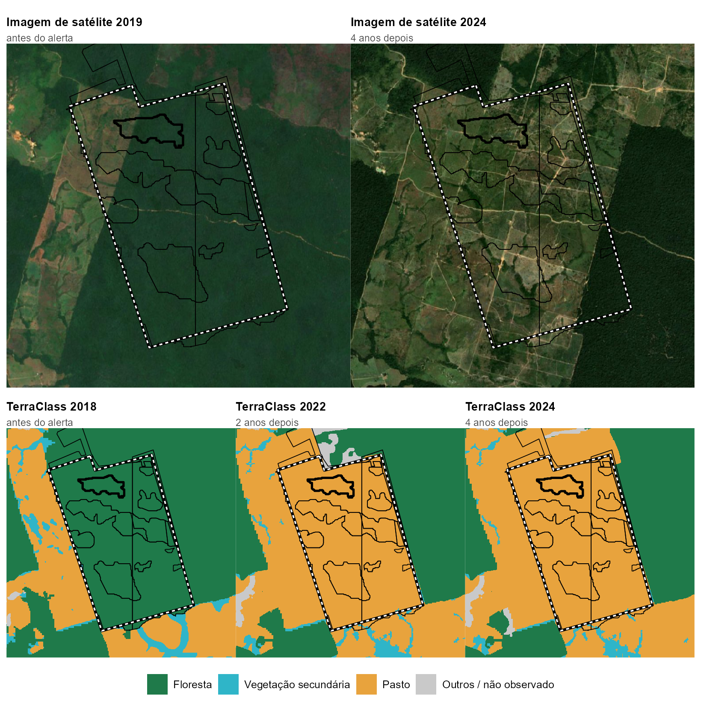

```{r}
#| label: setup
source("R/dados.R")
library(plotly)
library(gt)

data_publicacao <- "novembro de 2026"          # atualizar a cada edição (como no Apagão-SP)
ultimo_mes_label <- mes_pt(as.Date(paste0(ULTIMO_MES, "-01")))
a_ult <- AMZ[ano == ANO_FECHADO]; a_ant <- AMZ[ano == ANO_FECHADO - 1]
m_ult <- MIN[ano == ANO_FECHADO]
VERDE <- "#1F7A4A"; LARANJA <- "#E8A33D"; CINZA <- "#9a9a9a"

card <- function(valor, rotulo, nota = "") sprintf(
  "<div class='kpi-card'><div class='kpi-valor'>%s</div><div class='kpi-rotulo'>%s</div>%s</div>", valor, rotulo,
  if (nzchar(nota)) sprintf("<div class='kpi-variacao neutra'>%s</div>", nota) else "")
```

# Embargômetro {.pagina-titulo}

### Do alerta ao embargo: a resposta do poder público ao desmatamento na Amazônia Legal<br>edição de `r data_publicacao` · alertas até `r ultimo_mes_label` {.pagina-subtitulo}

#### De cada 100 hectares desmatados na Amazônia em `r ANO_FECHADO`, o Ibama embargou `r br(a_ult$ib730, 0)` em até dois anos {.manchete}

O satélite do Inpe detecta o desmatamento em dias. O embargo, que proíbe o uso da área desmatada ilegalmente, vem depois, quando vem. Em `r ANO_FECHADO`, o Ibama embargou `r br(a_ult$ib730)`% da área dos alertas de corte raso em até dois anos, abaixo dos `r br(a_ant$ib730)`% de `r ANO_FECHADO - 1`, o maior valor da série. `r ANO_FECHADO` é o ano mais recente com o prazo de dois anos encerrado.

```{r}
#| label: cards
#| results: asis
cat("<div class='kpi-grid'>",
  card(paste0(br(a_ult$ib730), "%"), sprintf("da área desmatada em %d embargada pelo Ibama em até 2 anos", ANO_FECHADO),
       sprintf("%s%% em %d", br(a_ant$ib730), ANO_FECHADO - 1)),
  card(paste0(br(MES_6M$ib182), "%"), sprintf("da área dos alertas de %s embargada em até 6 meses", mes_pt(MES_6M$data)),
       "o mês mais recente com 6 meses de prazo"),
  card(paste0(br(a_ult$ja_emb30), "%"), sprintf("do desmatamento de %d ocorreu em área que o Ibama já tinha embargado", ANO_FECHADO),
       "o \"embargo no papel\""),
  card(paste0(br(m_ult$ib730), "%"), sprintf("da área de alertas de mineração em %d embargada pelo Ibama em até 2 anos", ANO_FECHADO),
       "garimpo quase não é embargado"),
  "</div>", sep = "\n")
```

## A resposta do Ibama, ano a ano

Porcentagem da área dos alertas de corte raso com embargo do Ibama registrado em até dois anos depois do alerta.

```{r}
#| label: grafico-anual
d <- AMZ[ano <= ANO_FECHADO]
d[, `:=`(rot = fifelse(ano == 2016, "2016*", as.character(ano)), cor = fifelse(ano == 2016, CINZA, VERDE))]
plot_ly(d, x = ~rot, y = ~ib730, type = "bar", marker = list(color = ~cor),
        text = ~paste0(br(ib730), "%"), textposition = "outside", cliponaxis = FALSE,
        hovertext = ~sprintf("%s: %s%% de %s mil ha de alertas", rot, br(ib730), br(area_ha / 1e3)), hoverinfo = "text") |>
  layout(xaxis = list(title = "", type = "category"), yaxis = list(title = "% da área dos alertas", rangemode = "tozero", ticksuffix = "%"),
         margin = list(t = 20), showlegend = FALSE) |>
  config(displayModeBar = FALSE)
```

\* 2016 é parcial: a série do Deter começa em agosto de 2016. Os alertas de 2024 em diante ainda não completaram dois anos.

## Os meses mais recentes

O prazo de dois anos demora a fechar. Para acompanhar os alertas recentes, o observatório mede também quanto foi embargado em até seis meses.

```{r}
#| label: grafico-mensal-area
d <- MES[data >= seq(max(data), by = "-35 months", length.out = 2)[2]]
plot_ly(d, x = ~data, y = ~area_ha / 1e3, type = "bar", marker = list(color = LARANJA),
        hovertext = ~sprintf("%s: %s mil ha", mes, br(area_ha / 1e3)), hoverinfo = "text") |>
  layout(title = list(text = "Área dos alertas de corte raso por mês (mil ha)", font = list(size = 14), x = 0),
         xaxis = list(title = ""), yaxis = list(title = "mil ha", rangemode = "tozero"), margin = list(t = 40)) |>
  config(displayModeBar = FALSE)
```

```{r}
#| label: grafico-mensal-6m
d <- MES[!is.na(ib182) & data >= as.Date("2023-01-01")]
plot_ly(d, x = ~data, y = ~ib182, type = "scatter", mode = "lines+markers", line = list(color = VERDE, width = 2),
        marker = list(color = VERDE, size = 8),
        hovertext = ~sprintf("Alertas de %s: %s%% embargados em até 6 meses", mes, br(ib182)), hoverinfo = "text") |>
  layout(title = list(text = "% da área dos alertas do mês embargada pelo Ibama em até 6 meses", font = list(size = 14), x = 0),
         xaxis = list(title = ""), yaxis = list(title = "", rangemode = "tozero", ticksuffix = "%"), margin = list(t = 40)) |>
  config(displayModeBar = FALSE)
```

O último ponto é `r mes_pt(MES_6M$data)`, o mês mais recente com seis meses de prazo encerrados e registrados nas bases públicas.

## Por estado

Ibama, em até dois anos, % da área dos alertas de corte raso. A tabela está em ordem alfabética. **Ela não serve para ordenar os estados:** em alguns deles, os órgãos estaduais embargam mais que o Ibama. No Mato Grosso, por exemplo, o estado usa o auto de infração no lugar do embargo fora de áreas de preservação. A página de [metodologia](metodologia.qmd) explica as fontes estaduais.

```{r}
#| label: tabela-uf
t <- dcast(UF[ano >= 2017], uf ~ ano, value.var = "ib")
peq <- UF[ano >= 2017, .(peq = mean(base_pequena) > 0.5), by = uf]
t <- merge(t, peq, by = "uf"); t[, uf := fifelse(peq, paste0(uf, " †"), uf)][, peq := NULL]
gt(t) |> fmt_number(columns = -uf, decimals = 1, dec_mark = ",", sep_mark = ".") |> sub_missing(missing_text = "") |>
  cols_label(uf = "UF") |> tab_options(table.font.size = "0.9rem", data_row.padding = px(3)) |>
  tab_source_note("† Base pequena na maior parte dos anos (menos de 50 alertas ou de 1 mil ha). Fonte: Inpe (Deter) e Ibama; cálculo do observatório.")
```

## Garimpo

Nos alertas de mineração do Deter, categoria que inclui o garimpo, a resposta do Ibama em até dois anos ficou entre `r br(min(MIN[ano <= ANO_FECHADO, ib730]))`% e `r br(max(MIN[ano <= ANO_FECHADO, ib730]))`% da área de 2016 a `r ANO_FECHADO`. O valor mais alto, de `r ANO_FECHADO`, vem quase todo de um único embargo sobre o garimpo na Terra Indígena Yanomami, em Roraima.

## Um exemplo: de floresta a pasto embargado

{fig-alt="Mapas de uma área em Novo Progresso (PA): floresta em 2018 e 2019, pasto em 2022 e 2024, com o contorno dos alertas e do embargo."}

::: {.notas-rodape}
Linha preta grossa: um dos alertas, de 30/03/2020. Linhas finas: os outros alertas do Deter dentro do embargo. Tracejado branco: embargo do Ibama de 24/06/2020. Fontes: Inpe (Deter, TerraClass), Ibama (termos de embargo), Sentinel-2 cloudless 2019 e 2024, de EOX IT Services GmbH (contém dados Copernicus Sentinel modificados).
:::

::: {.caso-passos}
1. **Antes.** Em 2018, a área do retângulo, em Novo Progresso (PA), era floresta (99,7%, segundo o TerraClass).
2. **O alerta.** Entre fevereiro e março de 2020, o Deter emitiu 13 alertas de corte raso ali, somando cerca de 1,7 mil hectares.
3. **O embargo.** Em junho de 2020, o Ibama embargou 1.793 hectares, cobrindo todos os alertas, 86 dias depois do último.
4. **Depois.** Em 2022 e em 2024, 99,8% da área embargada era pasto. O embargo continua em vigor na lista do Ibama.
5. **A multa.** O Ibama não publica se as multas foram pagas. O observatório pediu esse dado pela Lei de Acesso à Informação.
:::

O caso foi escolhido por uma regra fixa, antes de olhar o mapa: um alerta típico em tamanho e no prazo até o embargo. O embargo, de quase 1,8 mil hectares, é bem maior que a média. O exemplo ilustra o caminho, e os números do observatório vêm de todos os alertas.

::: {.notas-rodape}
**Como ler.** O observatório cruza no mapa os alertas de desmatamento do Inpe (Deter) com os polígonos de embargo do Ibama, do ICMBio e de cinco estados. Não afirma causa: mostra o que dizem os registros oficiais. Um alerta sem embargo pode ter recebido outra sanção, ou um embargo que não está nas listas públicas. Detalhes em [Metodologia e dados](metodologia.qmd).
:::
